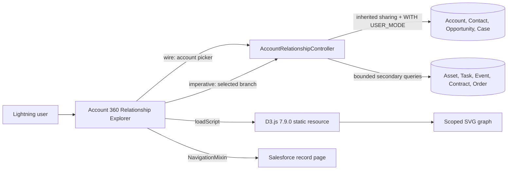

# Architecture

## Data flow and boundaries

`AccountRelationshipController` supplies deliberately small node and link DTOs instead of raw sObjects. The initial Account graph contains only direct Contacts, Opportunities, and Cases. The Account selector is limited to 20 records; each direct relation is limited to 75 records.

When a user selects **Explore related branches**, the LWC requests only that Account or Opportunity branch. Account expansion can add parent/child Accounts, Assets, Tasks, Events, Contracts, and Orders. Opportunity expansion can add Tasks and Events. Each secondary relationship type is limited to 25 records. The client deduplicates returned IDs before adding nodes and does not re-request an already expanded branch.

All controller queries use `WITH USER_MODE`, and the controller runs `inherited sharing`, preserving record sharing, CRUD, and field-level security. The UI receives a generalized error on authorization failures.

## Rendering lifecycle

The LWC loads D3 once using `lightning/platformResourceLoader` and scopes all D3 writes to its SVG. Before redraw it stops the preceding force simulation; it also stops the simulation on component disconnect. The graph uses force collision, grouped centres, curved links, SVG gradient definitions, keyboard interaction, hover tooltip text, and `prefers-reduced-motion` timing.

## D3 provenance

`force-app/main/default/staticresources/d3.resource` is the minified D3 7.9.0 distribution from npm. It is deployed as a local Salesforce static resource and is never loaded from a runtime CDN. See [third-party notices](../THIRD_PARTY_NOTICES.md) for the pinned npm integrity value, SHA-256, source URL, and ISC license.
